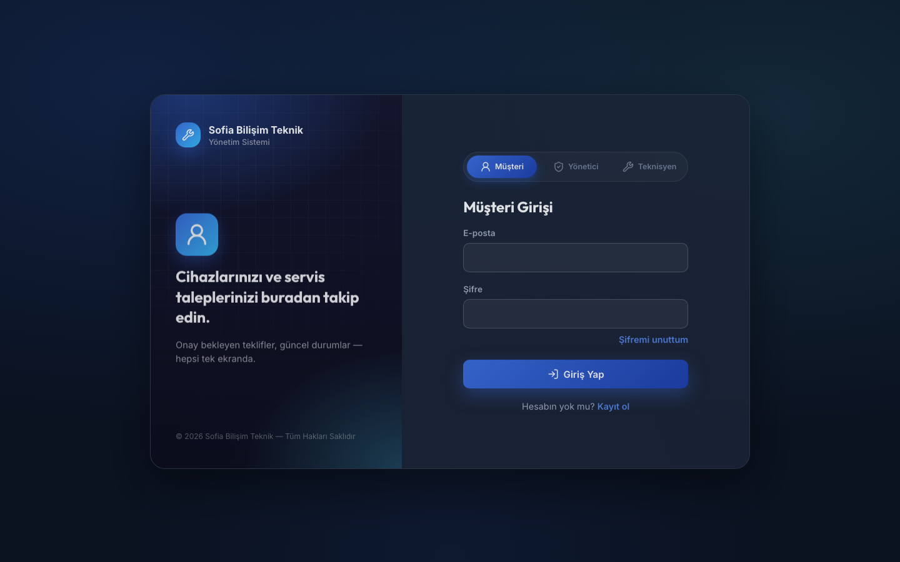
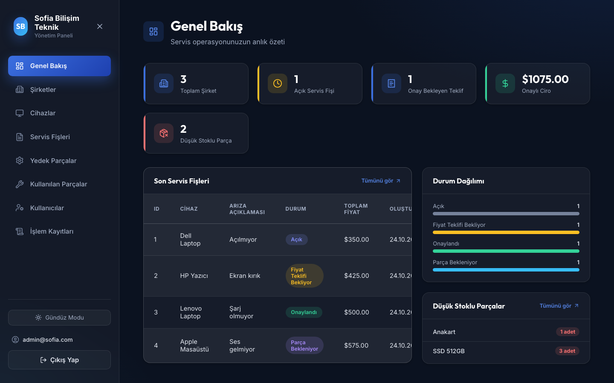
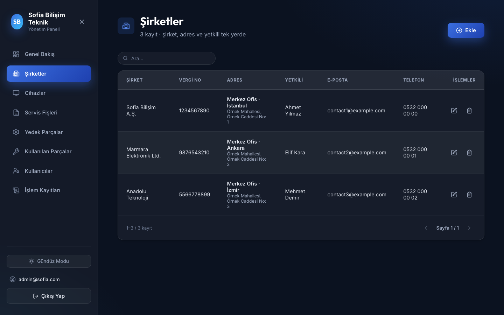
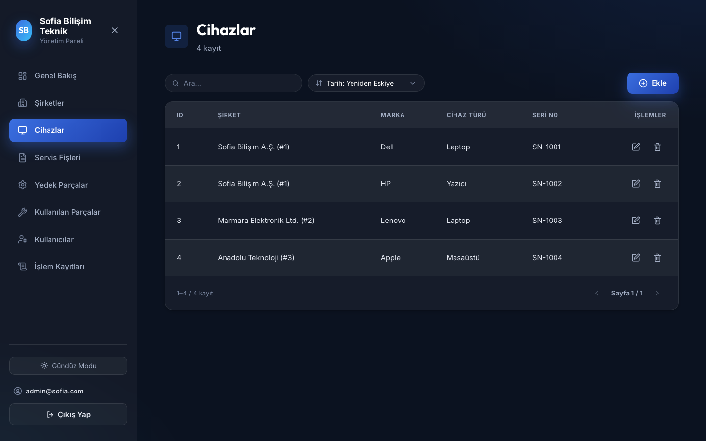
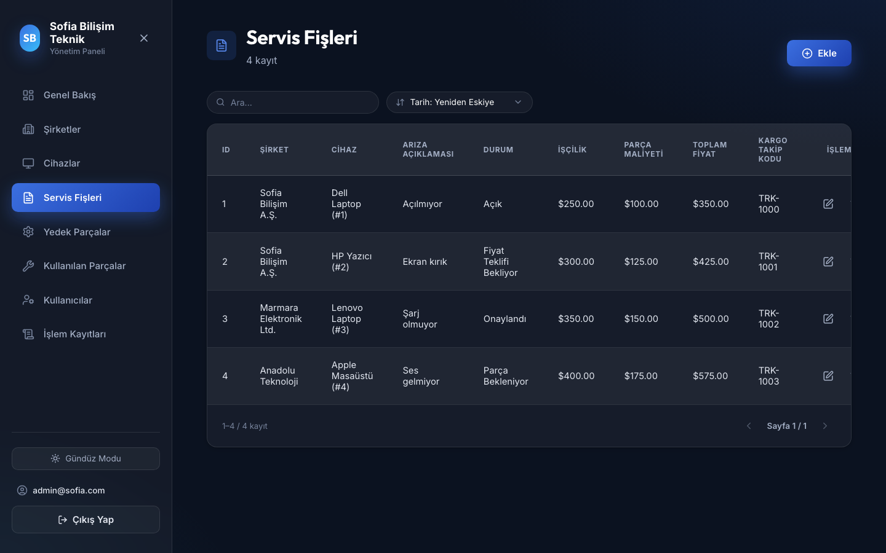
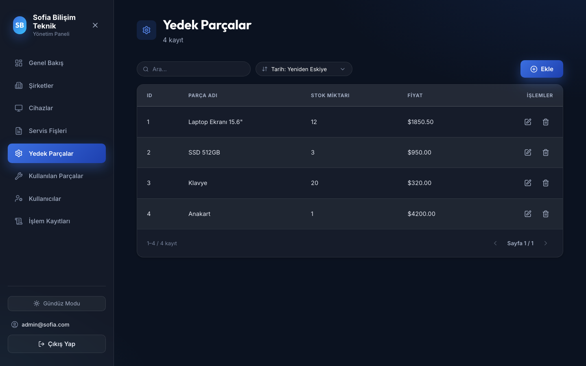
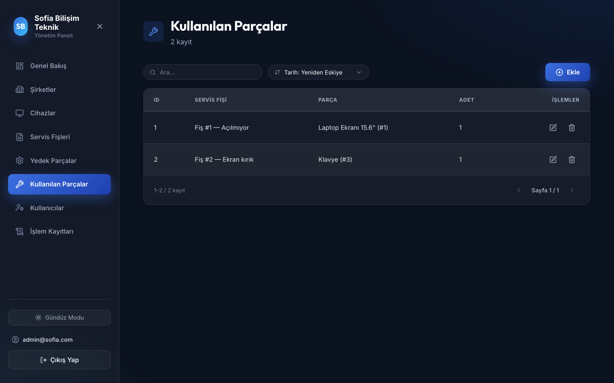
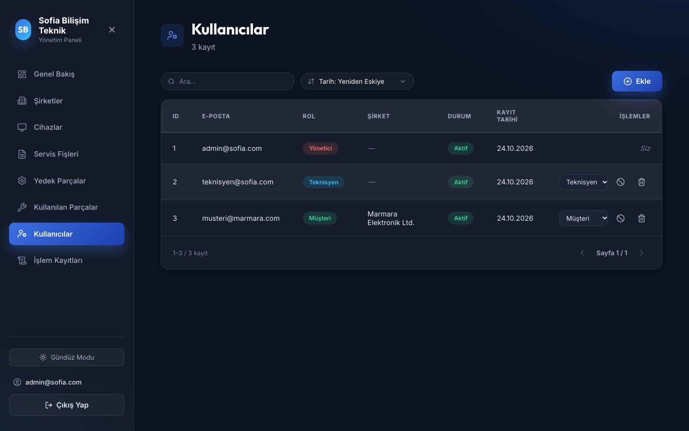
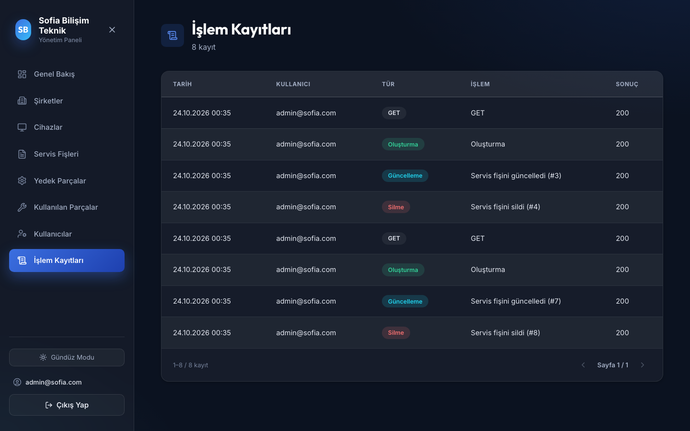

# Technical Service Simple — UI

Screenshots of a full-stack technical service management system I built for an internship project (backend: .NET / Dapper / PostgreSQL, frontend: React + TypeScript + Vite). The source code is kept in a private repository; this repo only showcases the UI.

## Screens

| | |
|---|---|
| **Login** | **Dashboard** |
|  |  |
| **Companies** | **Devices** |
|  |  |
| **Service Tickets** | **Spare Parts** |
|  |  |
| **Used Parts** | **Users** |
|  |  |
| **Audit Logs** | |
|  | |
